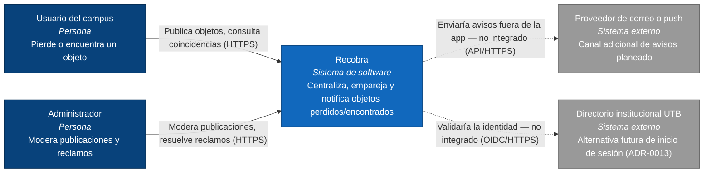

# C4-C1: Diagrama de Contexto — Recobra

Muestra a Recobra como una caja única y quiénes interactúan con ella: los
usuarios del campus, el administrador y los sistemas externos planeados
(proveedor de correo o push, directorio institucional).

**Leyenda:** azul oscuro = persona · azul = sistema Recobra · gris = sistema externo.
Las etiquetas de las flechas indican la acción y el protocolo.
Las notificaciones ya existen **dentro** de Recobra como bandeja de avisos
([ADR-0015](../adr/0015-notificaciones-en-la-aplicacion.md)); el proveedor de correo o push
queda como canal futuro, por eso su flecha es discontinua. La autenticación ya existe, pero **dentro**
de Recobra: cuentas con correo `@utb.edu.co` y sesiones propias
([ADR-0013](../adr/0013-cuentas-con-correo-institucional-y-sesiones-opacas.md)); el directorio
institucional queda como alternativa futura, por eso su flecha es discontinua (ver [`docs/context-map.md`](../context-map.md) para
el detalle de contextos delimitados).
