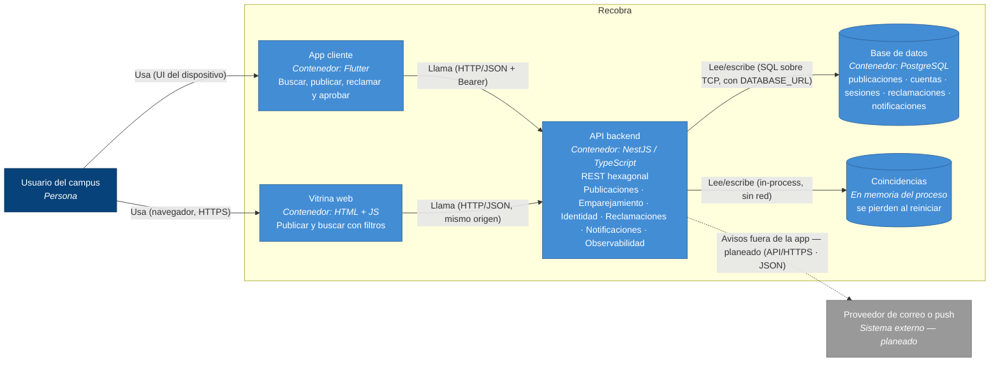

# C4-C2: Diagrama de Contenedores — Recobra

Hace zoom sobre el sistema Recobra del [C4-C1](C4-C1.md) y muestra sus
contenedores desplegables y el estado real de cada uno en el código.

Actualizado para el segundo corte (S10): refleja PostgreSQL activo,
Emparejamiento y búsqueda implementados, la vitrina web y el despliegue en
Dokploy. Lo que sigue siendo planeado se marca como tal.

| Contenedor | Estado en código | Notas |
|------------|------------------|-------|
| App cliente Flutter | Implementado | `mobile/` — versión web compilada en la imagen y servida por la API en `/app/`; estilo de la app UTB ([`docs/diseno-ui.md`](../diseno-ui.md)); buscar y ver coincidencias sin cuenta; iniciar sesión, publicar, reclamar, aprobar reclamaciones y ver avisos |
| Vitrina web | Implementado | `public/index.html`, servida por la propia API, con el mismo diseño de la app UTB ([`docs/diseno-ui.md`](../diseno-ui.md)); crear cuenta e iniciar sesión, publicar, buscar con filtros, ver coincidencias, reclamar, aprobar reclamaciones y ver avisos |
| API backend NestJS | Implementado | Publicaciones (`POST/GET /publicaciones`, búsqueda con filtros), Emparejamiento (`GET /coincidencias`), Identidad, Reclamaciones, Notificaciones (`GET /notificaciones`), `/health` y `/metrics` |
| PostgreSQL | Implementado | `PostgresPublicacionRepository` se activa con `DATABASE_URL`; sin ella la API usa memoria ([ADR-0006](../adr/0006-plataforma-persistencia-postgresql.md)) |
| Coincidencias | Implementado en PostgreSQL | `PostgresCoincidenciaRepository`, tabla `coincidencias` ([ADR-0018](../adr/0018-coincidencias-persistidas-y-parecido-ponderado.md)); en memoria solo sin `DATABASE_URL` |
| Identidad y Reclamaciones | Implementado dentro de la API | Cuentas `@utb.edu.co`, sesiones y reclamaciones con aprobación ([ADR-0013](../adr/0013-cuentas-con-correo-institucional-y-sesiones-opacas.md), [ADR-0014](../adr/0014-reclamacion-con-prueba-y-aprobacion.md)); tablas `cuentas`, `sesiones` y `reclamaciones` en la misma base |
| Notificaciones | Implementado dentro de la API | Bandeja de avisos por cuenta alimentada por eventos en proceso ([ADR-0015](../adr/0015-notificaciones-en-la-aplicacion.md)); tabla `notificaciones`. El proveedor de correo o push sigue planeado |

**Leyenda:** azul oscuro = persona · azul claro = contenedor · gris = externo.
Flechas discontinuas = relaciones planeadas aún no cableadas.

## Despliegue

La API se empaqueta con el [`Dockerfile`](../../Dockerfile) y se despliega en
Dokploy mediante [`deploy/compose.lab.yaml`](../../deploy/compose.lab.yaml);
el detalle del entorno está en la
[sección 7 de arc42](../arc42/arc42.md#7-vista-de-despliegue). Render dejó de
usarse (ver el ADR de migración a Dokploy en `docs/adr/`).

Decisiones: [ADR-0002](../adr/0002-arquitectura-y-stack.md),
[ADR-0003](../adr/0003-reto-corte1-stack-obligatorio.md),
[ADR-0004](../adr/0004-integracion-sincrona-vs-asincrona.md),
[ADR-0006](../adr/0006-plataforma-persistencia-postgresql.md),
[ADR-0008](../adr/0008-busqueda-con-filtros-en-el-repositorio.md).
