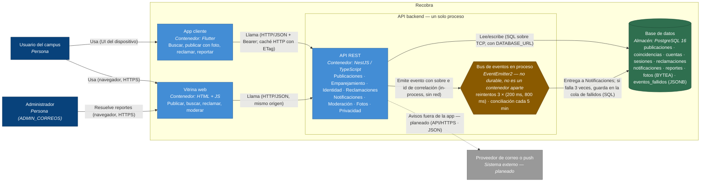

# C4-C2: Diagrama de Contenedores — Recobra

Hace zoom sobre el sistema Recobra del [C4-C1](C4-C1.md) y muestra sus
contenedores desplegables y el estado real de cada uno en el código.

Actualizado para la semana 12: muestra los **almacenes de datos y el bus de
eventos como piezas propias**, con su tecnología, y lo que ya no es cierto del
corte anterior (las coincidencias dejaron de vivir en memoria desde
[ADR-0018](../adr/0018-coincidencias-persistidas-y-parecido-ponderado.md)).
Lo que sigue siendo planeado se marca como tal.

| Contenedor o almacén | Tecnología | Estado en código | Notas |
|------------|------------|------------------|-------|
| App cliente Flutter | Flutter (Dart), versión web servida por la API en `/app/` | Implementado | `mobile/`; estilo de la app UTB ([`docs/diseno-ui.md`](../diseno-ui.md)); buscar sin cuenta; iniciar sesión, publicar (con foto), reclamar, aprobar, reportar y ver avisos |
| Vitrina web | HTML + JS, servida por la API | Implementado | `public/index.html`, mismo diseño; publicar con foto, buscar, reclamar, reportar, panel de reportes para administradores y avisos |
| API backend | NestJS 10 / TypeScript, hexagonal | Implementado | Publicaciones, Emparejamiento, Identidad, Reclamaciones, Notificaciones, Moderación, Fotos, Privacidad, Observabilidad (`/health`, `/metrics`). Es el único proceso del backend |
| **Base de datos** | **PostgreSQL 16** (servicio de Dokploy) | Implementado | **Almacén único** de los datos de todos los contextos, con **9 tablas**: `publicaciones`, `coincidencias`, `cuentas`, `sesiones`, `reclamaciones`, `notificaciones`, `reportes`, `fotos` (`BYTEA`) y `eventos_fallidos` (`JSONB`). Cada tabla tiene un solo dueño y no hay claves foráneas entre contextos ([ADR-0027](../adr/0027-la-decision-de-datos-mas-costosa-de-revertir.md), `docs/modulo-datos.md`). Sin `DATABASE_URL`, la API usa adaptadores en memoria (solo pruebas locales) |
| **Bus de eventos en proceso** | EventEmitter2 (`@nestjs/event-emitter`) | Implementado, **no es un contenedor aparte** | Vive dentro del proceso de la API. Entrega asíncrona y **no durable** de cuatro tipos de evento a Notificaciones, con reintentos, **cola de fallidos** (`eventos_fallidos`) y conciliación por estado ([ADR-0026](../adr/0026-entrega-de-avisos-con-eventos-reintentos-y-cola-de-fallidos.md), [contrato](../contracts/eventos.md)). Un broker externo (RabbitMQ, Redis Streams) se evaluó y se descartó: ver la alternativa B del ADR |
| Caché | HTTP (ETag y `Cache-Control`) | Implementado, **sin servidor de caché** | No hay Redis ni caché de datos en el servidor; la política HTTP está en [ADR-0025](../adr/0025-diseno-de-cache-y-politica-de-invalidacion.md) y arc42 §8.3 |
| Proveedor de correo o push | — | **Planeado** | Hoy los avisos solo se ven dentro de la aplicación ([ADR-0015](../adr/0015-notificaciones-en-la-aplicacion.md)) |

**Leyenda:** azul oscuro = persona · azul claro = contenedor · verde = almacén de
datos · ocre = bus de eventos (dentro del proceso de la API) · gris = externo.
Flechas discontinuas = relaciones planeadas aún no cableadas.

## Seguridad

El [modelo de amenazas](../seguridad/modelo-de-amenazas.md) de la S13 ancla cada amenaza en un elemento de este diagrama y marca las fronteras de confianza: **TB1** (Internet → Traefik y API), **TB2** (API → PostgreSQL) y **TB3** (repositorio público → despliegue). Dentro de la API, el módulo `src/seguridad/` aplica las cabeceras, CORS, el origen del cliente y los límites de uso antes que cualquier controlador (arc42 §8.6).

## Despliegue

La API se empaqueta con el [`Dockerfile`](../../Dockerfile) y se despliega en
Dokploy mediante [`deploy/compose.lab.yaml`](../../deploy/compose.lab.yaml);
el detalle del entorno está en la
[sección 7 de arc42](../arc42/arc42.md#7-vista-de-despliegue). Render dejó de
usarse (ver el ADR de migración a Dokploy en `docs/adr/`).

Decisiones: [ADR-0002](../adr/0002-arquitectura-y-stack.md),
[ADR-0003](../adr/0003-reto-corte1-stack-obligatorio.md),
[ADR-0004](../adr/0004-integracion-sincrona-vs-asincrona.md),
[ADR-0006](../adr/0006-plataforma-persistencia-postgresql.md),
[ADR-0008](../adr/0008-busqueda-con-filtros-en-el-repositorio.md),
[ADR-0025](../adr/0025-diseno-de-cache-y-politica-de-invalidacion.md),
[ADR-0026](../adr/0026-entrega-de-avisos-con-eventos-reintentos-y-cola-de-fallidos.md),
[ADR-0027](../adr/0027-la-decision-de-datos-mas-costosa-de-revertir.md).
