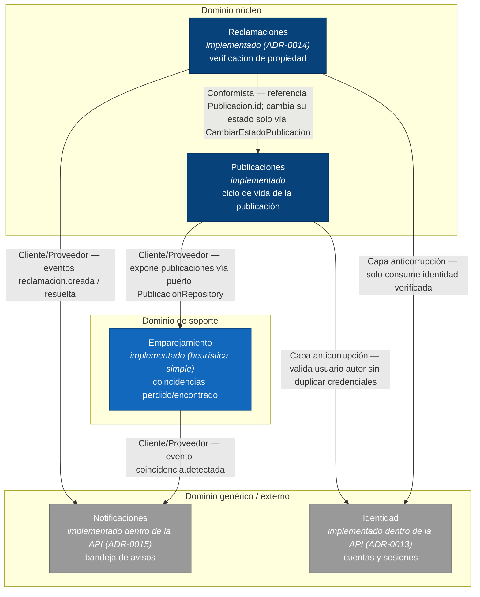

# Mapa de contextos delimitados (Bounded Context Map) — Recobra

Contextos derivados del dominio descrito en el [README](../README.md), el
[C4 nivel 1](c4/C4-C1.md) y los [escenarios de calidad](calidad/escenarios_calidad.md).
Solo **Publicaciones** tiene código implementado en el corte 1; el resto está
documentado como objetivo para que las fronteras de datos queden decididas
antes de escribirlos (evita que dos módulos futuros terminen leyendo/escribiendo
la misma tabla).

## Diagrama

**Leyenda:** azul oscuro = dominio núcleo (donde está la ventaja competitiva del
proyecto) · azul claro = dominio de soporte · gris = genérico o externo, con
patrón de integración *Capa anticorrupción* porque Recobra no controla su
modelo de datos.

## Contextos y su rol

| Contexto | Tipo (DDD) | Rol en el negocio | Estado |
|---|---|---|---|
| **Publicaciones** | Núcleo | Registrar y consultar objetos perdidos/encontrados; dueño del ciclo de vida `publicado → en contacto → reclamado/cerrado` | Implementado (`src/domain`, `src/application`, `src/publicaciones`) |
| **Reclamaciones** | Núcleo | Verificar que quien reclama un objeto tiene derecho a hacerlo (aspecto A3, escenario S2) | Implementado (`src/reclamaciones/`, `src/application/use-cases/reclamaciones.ts`, ADR-0014) |
| **Emparejamiento (Matching)** | Soporte | Comparar publicaciones de "perdido" y "encontrado" y producir coincidencias (escenario S3) | Implementado (misma categoría y parecido ponderado de lugar, palabras y fecha con umbral 0,3, ADR-0018; ver `src/emparejamiento/`, `src/domain/emparejamiento/parecido.ts` y `src/application/use-cases/buscar-coincidencias.ts`) |
| **Notificaciones** | Genérico | Avisar a cada cuenta de coincidencias y reclamaciones (escenario S3) | Implementado dentro de la API como bandeja de avisos (`src/notificaciones/`, `src/application/use-cases/notificaciones.ts`, ADR-0015); correo o push quedan como canal futuro |
| **Identidad** | Genérico | Cuentas con correo institucional y sesiones | Implementado dentro de la API (`src/identidad/`, ADR-0013); un proveedor institucional externo queda como alternativa futura detrás de los mismos puertos |

## Patrones de relación entre contextos

- **Publicaciones → Emparejamiento (Cliente/Proveedor):** implementado.
  `CrearPublicacion` emite el evento `publicacion.creada` (en proceso, ver
  ADR-0004) sin esperar su resultado; `PublicacionCreadaListener` lo consume
  y llama a `BuscarCoincidencias`, que lee publicaciones vía el puerto
  `PublicacionRepository` (nunca escribe sobre sus datos) y guarda sus
  propios resultados en `CoincidenciaRepository`.
- **Emparejamiento → Publicaciones ("Lo tengo yo", ADR-0019):** Emparejamiento
  crea la publicación de encontrado a través de `CrearPublicacion`, el caso de
  uso de Publicaciones, y solo escribe su propia tabla de coincidencias.
- **Emparejamiento → Notificaciones y Reclamaciones → Notificaciones
  (Cliente/Proveedor):** implementado (ADR-0015). Emparejamiento emite
  `coincidencia.detectada` (solo ids y score) y Reclamaciones emite
  `reclamacion.creada` y `reclamacion.resuelta`; `NotificacionesListener` los
  consume en proceso y guarda avisos en su propia tabla. Un fallo de
  Notificaciones no afecta a quien publicó o reclamó (S4a).
- **Reclamaciones → Publicaciones (Conformista):** Reclamaciones referencia
  una publicación por su `id` y no copia ni reinterpreta sus campos; si
  Publicaciones cambia su modelo, Reclamaciones se ajusta, no al revés.
- **Reclamaciones → Identidad y Publicaciones → Identidad (Capa
  anticorrupción):** Identidad es un sistema externo (C4 nivel 1); tanto
  Publicaciones (para asociar un autor) como Reclamaciones (para verificar al
  reclamante) traducen la respuesta de Identidad a su propio modelo interno de
  "usuario" en vez de propagar el modelo externo hacia el dominio.

## Diferencia con los límites del corte 1

Los límites de contexto **no cambiaron** desde el corte 1 (etiqueta `corte-1`,
commit `f7c1a6c`): el único contexto con código real sigue siendo
**Publicaciones** (`src/domain/`, `src/application/`, `src/publicaciones/`).
Este mapa documenta el diseño objetivo de los demás contextos
(Reclamaciones, Emparejamiento, Notificaciones, Identidad) para decidir sus
fronteras de datos antes de escribir código, no un cambio ya implementado.
Por eso no aplica un diff de C4 nivel 3 ni un ADR nuevo de límites en esta
semana: no hay una frontera que se haya movido, solo una que se documentó
con anticipación.

## Relación con la arquitectura hexagonal (ADR-0002)

Cada contexto delimitado, cuando se implemente, sigue la misma regla que ya
aplica a Publicaciones (ver [`docs/arc42/arc42.md`](arc42/arc42.md#4-estrategia-de-solución)):
el dominio del contexto no depende de los adaptadores de los demás contextos;
la comunicación entre contextos ocurre a través de puertos o eventos, nunca
importando entidades ajenas directamente. Esto es lo que hace posible la
regla de dueño único de datos documentada en
[`docs/modulo-datos.md`](modulo-datos.md).
