# Modelo de amenazas de Recobra (STRIDE sobre el C4)

Evidencia de la semana 13. Parte de los elementos reales del
[C4 nivel 2](../c4/C4-C2.md) (contenedores, almacenes y bus de eventos) y del
[nivel 3](../c4/C4-C3.md) (componentes de la API), no de una lista genérica. Las
decisiones estructurales están en [ADR-0028](../adr/0028-limites-de-uso-por-cuenta-y-por-origen.md),
[ADR-0029](../adr/0029-cabeceras-de-seguridad-csp-y-cors.md) y
[ADR-0030](../adr/0030-seguridad-en-el-pipeline-dependencias-secretos-y-permisos.md);
la arquitectura de seguridad resultante, en [arc42 §8.6](../arc42/arc42.md#86-arquitectura-de-seguridad);
lo que se acepta, en [arc42 §11](../arc42/arc42.md#112-riesgos-y-deuda).

## 1. Método

1. **Elementos y flujos.** Se tomaron los elementos del C4 (persona, app, vitrina,
   API y sus componentes, bus de eventos, PostgreSQL) y se agregaron los dos que el C4
   de aplicación no dibuja pero que también se atacan: el **despliegue** (Dokploy y su
   webhook) y el **pipeline** (GitHub Actions, la imagen y las dependencias).
2. **STRIDE por elemento y por flujo.** Para cada elemento se preguntó por
   Suplantación (S), Manipulación (T), Repudio (R), Divulgación de información (I),
   Denegación de servicio (D) y Elevación de privilegios (E). Salieron 26
   amenazas (T20, leer fotos o pruebas de otras personas, se fundió con T12); las que no
   aplicaban a ningún elemento real se descartaron.
3. **Priorización.** Probabilidad (P) e impacto (I) de 1 a 5; **riesgo = P × I**.
   *Crítica* ≥ 20 · *Alta* 12–19 · *Media* 6–11 · *Baja* ≤ 5.
   - P: 1 casi imposible · 2 poco probable · 3 posible · 4 probable · 5 ya ocurrió o es trivial.
   - I: 1 molestia · 2 afecta a una persona · 3 afecta a varias o a la operación ·
     4 expone datos o tumba el servicio · 5 control total o daño irreversible.
4. **Plan.** Se atacó primero lo de mayor riesgo (§4). Cada mitigación dice quién la
   aplica y si está **hecha**, **pendiente** o **aceptada** como riesgo (con el motivo en
   arc42 §11).

**Qué no se hizo:** pruebas de penetración ni auditoría externa (no se exigen). Las
probabilidades son estimaciones del equipo, no mediciones; se revisan al cambiar la
arquitectura.

## 2. Fronteras de confianza y flujos

```mermaid
flowchart LR
    subgraph internet["Internet — no confiable"]
        atacante["Atacante<br/><i>cualquiera con la URL</i>"]
        usuario["Persona de la comunidad<br/><i>cuenta @utb.edu.co</i>"]
        admin["Administrador<br/><i>ADMIN_CORREOS</i>"]
    end

    subgraph cliente["Dispositivo y navegador de la persona — semiconfiable"]
        app["App Flutter<br/><i>token en preferencias</i>"]
        web["Vitrina web<br/><i>token en localStorage</i>"]
    end

    subgraph lab["Servidor del laboratorio (Dokploy) — frontera TB1"]
        traefik["Traefik<br/><i>TLS · proxy de confianza (1 salto)</i>"]
        subgraph proc["Proceso de la API (NestJS)"]
            seg["Cabeceras · CORS · límites · 415<br/><i>ADR-0028 y 0029</i>"]
            api["Guardias y casos de uso<br/><i>autenticación, autoría, administrador</i>"]
            bus{{"Bus de eventos<br/><i>reintentos · cola de fallidos</i>"}}
        end
        bd[("PostgreSQL<br/><i>9 tablas · fotos · cola</i>")]
        panel["Panel de Dokploy<br/><i>variables, webhook, respaldos</i>"]
    end

    subgraph gh["GitHub y CI/CD — frontera TB3"]
        repo["Repositorio público<br/><i>código e historial</i>"]
        ci["GitHub Actions<br/><i>pruebas · seguridad · imagen</i>"]
    end

    atacante -->|"DF1 · HTTPS<br/>T05 T06 T07 T08 T11 T14 T21"| traefik
    usuario --> app
    usuario --> web
    admin --> web
    app -->|"DF2 · HTTP/JSON + Bearer<br/>T02 T12 T19"| traefik
    web -->|"DF3 · HTTP/JSON, mismo origen<br/>T03 T04 T22"| traefik
    traefik --> seg --> api
    api -->|"DF4 · eventos en proceso<br/>T18"| bus
    api -->|"DF5 · SQL parametrizado<br/>T11 T25"| bd
    bus -->|"DF6 · cola de fallidos"| bd
    repo -->|"DF7 · push → CI → imagen → webhook<br/>T15 T16 T17"| ci
    ci -->|"DF8 · despliegue"| panel
    panel --> proc
    panel -.->|"DF9 · respaldos<br/>T26"| bd

    classDef persona fill:#08427b,color:#fff,stroke:#052e56;
    classDef cont fill:#438dd5,color:#fff,stroke:#2e6295;
    classDef almacen fill:#2f6f4f,color:#fff,stroke:#1d4a34;
    classDef riesgo fill:#8a2a2a,color:#fff,stroke:#5c1b1b;
    class usuario,admin persona;
    class app,web,traefik,seg,api,bus,panel,repo,ci cont;
    class bd almacen;
    class atacante riesgo;
```

Las fronteras donde se cruza de menos a más confianza son **TB1** (de Internet al
servidor: toda entrada se trata como hostil), **TB2** (de la API a PostgreSQL: solo
consultas parametrizadas) y **TB3** (del repositorio público al despliegue: lo que se
sube se ejecuta en producción).

## 3. Tabla de amenazas, ordenada por riesgo

**Cat.** = categoría STRIDE. **Dueño**: quién aplica la mitigación. **Estado**: ✅ hecha ·
🟡 parcial · ⏳ pendiente · ⚖️ aceptada (motivo en arc42 §11).

| ID | Cat. | Elemento del C4 | Amenaza concreta | P | I | Riesgo | Prioridad | Mitigación | Dueño | Estado | Evidencia |
|---|---|---|---|:-:|:-:|:-:|---|---|---|---|---|
| **T15** | I, E | PostgreSQL y panel de Dokploy (DF7, DF8) | La contraseña de la base y la URL del webhook de despliegue se mostraron en capturas de pantalla (fuera del repositorio). Con ellas alguien lee o altera todos los datos, o redespliega a voluntad | 5 | 5 | **25** | Crítica | Rotar la contraseña (`ALTER USER`), cerrar el puerto externo de la base y regenerar el webhook; barrido de secretos del historial en cada commit para que no se repita en el código | Camilo (Dokploy) | ⏳ **Pendiente: lo hace el dueño del panel**; barrido ✅ | [`barrido-de-secretos.md`](barrido-de-secretos.md), `scripts/barrido-secretos.js` |
| **T01** | S, E | API (Identidad) y variable `ADMIN_CORREOS` | El correo no se verifica por propiedad: quien registre primero un correo de `ADMIN_CORREOS` (antes que su dueño) es administrador y puede ocultar publicaciones y ver los reportes | 3 | 5 | **15** | Alta | Orden operativo (registrar la cuenta y después listarla); advertencia al arrancar y cada 6 h por cada correo de administrador sin cuenta, advertencia al registrar uno y métrica; verificación del correo por código (requiere proveedor de correo) | Camilo (orden y revisión), código ✅ | 🟡 Detección ✅; verificación ⚖️ | `verificar-administradores.ts` y su spec; `/metrics` → `seguridad.administradoresSinCuenta` |
| **T05** | D | API REST (publicar, reclamar, reportar, foto) → PostgreSQL | Una cuenta crea publicaciones, fotos de 1 MB, reportes o reclamaciones sin tope y llena la base compartida del laboratorio o inunda a otras personas | 4 | 3 | **12** | Alta | Límites de uso por cuenta (publicar 20/h, reclamar 10/h, reportar 20/día, foto 30/h) con 429 y `Retry-After` ([ADR-0028](../adr/0028-limites-de-uso-por-cuenta-y-por-origen.md)) | Camilo | ✅ | `limite-de-uso.ts`, `test/limites.e2e-spec.ts` |
| **T07** | D | API REST (lector de cuerpos de Express) | Un solo cuerpo comprimido con bytes de más tumba el proceso (GHSA-27r3-jxmh-p828 en `body-parser`) | 3 | 4 | **12** | Alta | Rechazo con 415 de todo `Content-Encoding` antes del lector, y `body-parser` 1.20.9 | Camilo | ✅ | `configurar-seguridad.ts`, `test/seguridad.e2e-spec.ts` (el ataque real) |
| **T09** | I | API (FotosController), vitrina y app | La foto de un objeto encontrado permite reclamarlo sin ser su dueño | 3 | 4 | **12** | Alta | Foto completa solo para su autor y para quien tiene la reclamación aprobada; el público ve una miniatura de 24 px ([ADR-0023](../adr/0023-fotos-con-privacidad.md)) | Camilo | ✅ (18-oct) | `test/fotos.e2e-spec.ts` |
| **T10** | I | API (FotosController) | La foto de un celular lleva la ubicación exacta (EXIF) de quien la tomó | 4 | 3 | **12** | Alta | El servidor quita EXIF, XMP y comentarios al recibir la foto | Camilo | ✅ (18-oct) | `jpeg.ts`, `jpeg.spec.ts` |
| **T16** | T | API (imagen Docker) y pipeline | Dependencias con vulnerabilidades conocidas (10 en producción al empezar la semana, 1 crítica) | 3 | 4 | **12** | Alta | Actualizar lo actualizable (10 → 7, 0 críticas); control en CI que falla ante un aviso sin revisar o una decisión vencida; Dependabot; los 7 restantes revisados uno a uno; migrar NestJS ([ADR-0030](../adr/0030-seguridad-en-el-pipeline-dependencias-secretos-y-permisos.md)) | Camilo | 🟡 | [`analisis-de-dependencias.md`](analisis-de-dependencias.md), `scripts/revisar-dependencias.js` |
| **T02** | S | API (Identidad) | Registrar el correo de otra persona para publicar o reclamar en su nombre, o impedirle registrarse | 3 | 3 | 9 | Media | La entrega siempre la aprueba una persona y el contacto se revela solo tras aprobar; la eliminación de la cuenta pide la contraseña. La verificación del correo exige un proveedor de correo | Equipo | ⚖️ Aceptada hasta tener proveedor | arc42 §11.2, ADR-0013 |
| **T06** | D | API REST (`POST /cuentas`) | Registro masivo automatizado de cuentas | 3 | 3 | 9 | Media | Límite por origen de 60 cuentas por hora (holgado: la red del campus comparte dirección) | Camilo | ✅ | `test/limites.e2e-spec.ts` |
| **T26** | I | PostgreSQL (respaldos, DF9) | Los respaldos conservan lo que la aplicación ya borró (fotos, cuentas eliminadas) | 3 | 3 | 9 | Media | Retención corta (7–14 días) en el respaldo programado y decidir con la UTB si el aviso de privacidad lo menciona | Camilo (Dokploy) y UTB | ⏳ Pendiente | [`respaldos.md`](../despliegue/respaldos.md) |
| **T03** | I, S | Vitrina web (DF3) | Un script inyectado (XSS) lee el token de `localStorage` y toma la cuenta | 2 | 4 | 8 | Media | Todo se pinta con `textContent` (una prueba lo exige); CSP que solo permite el script de la vitrina por hash, verificada en un navegador; el token vence a los 7 días | Camilo | ✅ | `seguridad-http.spec.ts` (guardia de la vitrina) |
| **T04** | I | Canal HTTPS (DF1, DF2, DF3) | Intercepción o degradación a HTTP | 2 | 4 | 8 | Media | HTTPS en Traefik y `Strict-Transport-Security` (seis meses, sin subdominios) | Camilo | ✅ | `cabeceras-de-seguridad.ts` |
| **T12** | T, E | API (guardias y casos de uso) | Hacerse pasar por el autor o cambiar estados desde el cliente (escalada horizontal) | 2 | 4 | 8 | Media | La cuenta sale siempre del token, nunca del cuerpo; cada operación comprueba autoría o rol; cambios de estado de comparar y fijar | Camilo | ✅ | `test/reclamaciones.e2e-spec.ts`, `test/fotos.e2e-spec.ts` (403) |
| **T17** | T | Pipeline (DF7, DF8) | Compromiso de una acción de terceros o de la imagen base para ejecutar código en el flujo | 2 | 4 | 8 | Media | Acciones fijadas por SHA, imagen de PostgreSQL por digest, permisos mínimos del flujo (`contents: read`) | Camilo | ✅ | `.github/workflows/ci.yml` |
| **T27** | I, D | App Flutter web | La app pide la fuente a `fonts.gstatic.com` en cada arranque: cuenta a Google quién la usa y depende de un tercero | 4 | 2 | 8 | Media | Roboto va empaquetada (licencia Apache 2.0) y la CSP no admite hosts de terceros | Camilo | ✅ | `mobile/assets/fonts/`, `pubspec.yaml` |
| **T08** | S, D | API (IniciarSesion) | Fuerza bruta de contraseñas; o bloquear la cuenta de otra persona fallando a propósito | 3 | 2 | 6 | Media | 5 fallos por correo en 15 min (429), 300 inicios por origen en 15 min, scrypt, mismo mensaje y mismo tiempo con o sin cuenta. Residual: bloquear 15 min un correo ajeno | Camilo | ✅ / ⚖️ residual | `control-de-intentos.spec.ts` |
| **T19** | I | App Flutter (dispositivo) | El token queda en las preferencias del dispositivo sin cifrar (robo físico o malware) | 2 | 3 | 6 | Media | Vence a los 7 días y se revoca al cerrar sesión. Almacenamiento seguro del sistema queda como mejora | Equipo | ⚖️ Aceptada | arc42 §11.2 |
| **T22** | T | Vitrina web | Meter la vitrina en un marco de otra página para engañar con clics | 2 | 3 | 6 | Media | `frame-ancestors 'none'` y `X-Frame-Options: DENY` | Camilo | ✅ | `test/seguridad.e2e-spec.ts` |
| **T24** | S | API (origen del cliente) | Falsificar `X-Forwarded-For` para esquivar los límites por origen | 3 | 2 | 6 | Media | Un salto de proxy de confianza (Traefik) y `proxy-addr` parcheado. Residual: si el servicio se expusiera sin proxy | Camilo | ✅ / ⚖️ residual | `seguridad-http.spec.ts` |
| **T11** | T | API → PostgreSQL (DF5) | Inyección SQL por filtros, textos o correos | 1 | 5 | 5 | Baja | Todas las consultas van parametrizadas (cero interpolaciones en los adaptadores) y hay una prueba con entradas hostiles contra memoria y PostgreSQL real | Camilo | ✅ | `test/adaptadores.e2e-spec.ts` («Entradas hostiles») |
| **T14** | I | API (Identidad) | Saber qué correos tienen cuenta por el mensaje del registro | 4 | 1 | 4 | Baja | Los correos institucionales no son secretos; el inicio de sesión no lo revela | Equipo | ⚖️ Aceptada | arc42 §11.2 |
| **T13** | R | API (Moderación) | Un administrador oculta una publicación y lo niega | 2 | 2 | 4 | Baja | `resueltoPor` y `resueltoEn` en la base y una línea de auditoría en el registro | Camilo | ✅ | `test/moderacion.e2e-spec.ts` |
| **T18** | D | Bus de eventos y cola de fallidos (DF4, DF6) | La cola de eventos fallidos crece y nadie se entera | 2 | 2 | 4 | Baja | Alerta: línea de error, métrica y aviso al administrador. Residual: si la base de avisos cae, el aviso en la aplicación no se puede guardar (quedan el registro y la métrica) | Camilo | 🟡 | [ADR-0026](../adr/0026-entrega-de-avisos-con-eventos-reintentos-y-cola-de-fallidos.md) |
| **T21** | I | API (CORS) | Cualquier sitio podía leer las respuestas de la API desde el navegador de una persona | 2 | 2 | 4 | Baja | CORS con lista blanca (por omisión, ningún origen externo) | Camilo | ✅ | `seguridad-http.spec.ts` |
| **T23** | I | API (registros) | Datos personales en los registros del servidor | 2 | 2 | 4 | Baja | Los registros llevan ids y huellas, no correos ni textos; los límites registran una huella del origen, no la dirección. Única excepción deliberada: la advertencia de «administrador sin cuenta» nombra el correo configurado, porque quien opera lo necesita para actuar | Camilo | ✅ | `limite-de-uso.spec.ts` |
| **T25** | D | API (FotosController) | Una imagen malformada o enorme daña al servidor | 2 | 2 | 4 | Baja | El servidor no decodifica imágenes: revisa la cabecera, el tamaño (1 MB) y las medidas declaradas (2048 px) | Camilo | ✅ | `foto.spec.ts` |

Ordenadas por riesgo; a igual riesgo, por impacto.

## 4. El plan ataca primero lo priorizado

| Orden | Amenaza (riesgo) | Qué se hizo y cuándo | Estado |
|---|---|---|---|
| 1 | **T15** (25, crítica) | Barrido de secretos de los 180 commits y de todas las ramas: **limpio** (el filtrado fue fuera del repositorio). Se convirtió en un control de CI con prueba de que detecta un secreto plantado y ya borrado. La rotación de la contraseña y del webhook es de quien administra Dokploy | Barrido ✅ · **rotación ⏳** |
| 2 | **T01** (15, alta) | Detección de correos de administrador sin cuenta (al arrancar y cada 6 h), advertencia al registrar uno y métrica | ✅ detección · verificación ⚖️ |
| 3 | **T05, T07, T09, T10, T16** (12, altas) | T05 límites de uso y T07 rechazo de cuerpos comprimidos y `body-parser` parcheado (28-oct); T16 dependencias de 10 a 7 avisos con control en CI (28-oct); **T09 y T10 ya estaban resueltas** desde las fotos (18-oct, antes de este modelo) | ✅ / 🟡 |
| 4 | **T02, T06, T26, T03, T04, T12, T17, T27** (6–9, medias) | T06 límite por origen; T03, T04 cabeceras y CSP; T17 permisos mínimos; T27 fuente empaquetada; T12 ya cubierta por pruebas previas; T02 aceptada y T26 pendiente de Dokploy | ✅ / ⚖️ / ⏳ |
| 5 | **T08, T19, T22, T24** (6, medias) y las **bajas** | Lo que se pudo cerrar con el mismo trabajo (T22, T24, T21, T13, T11, T18); T19 y T14 aceptadas | ✅ / ⚖️ |

Se atendieron de mayor a menor riesgo; lo de riesgo menor que ya estaba hecho antes
(T09, T10, T12, T11) se señala como tal y no se cuenta como trabajo de esta semana.

## 5. Mitigaciones pendientes y riesgos aceptados

| ID | Qué falta | Quién | Por qué no está hecho |
|---|---|---|---|
| T15 | Rotar la contraseña de PostgreSQL, cerrar el puerto externo y regenerar el webhook | Camilo (Dokploy) | Solo se puede hacer desde el panel del servidor; la guía paso a paso está entregada |
| T26 | Configurar el respaldo programado con retención corta y decidir con la UTB si el aviso debe mencionarlo | Camilo y la UTB | Depende del panel y de una decisión de la universidad |
| T16 | Migrar NestJS 10 a 11 o 12 (quita los 7 avisos restantes) | Equipo | Es un cambio de versión mayor (Express 5); está planeado con fecha límite 15-dic-2026 y los avisos aceptados vencen ese día |
| T01 / T02 | Verificar la propiedad del correo con un código | Equipo | Necesita un proveedor de correo; ver arc42 §11.2 |

## 6. Componente generativo

**Recobra no incorpora ningún componente generativo** ([ADR-0007](../adr/0007-no-incorporar-componente-generativo.md)):
no hay un modelo de lenguaje en tiempo de ejecución ni se envía contenido de las personas a uno. Por eso
no hay riesgos propios de inyección de instrucciones, fuga de datos hacia un modelo ni
envenenamiento del contexto que modelar. Si algún día se incorporara, el modelo debería
agregar: texto de las publicaciones y de las pruebas como entrada **no confiable** (inyección),
el aislamiento de los datos de cada persona en el contexto (fuga) y quién puede escribir en lo que
el modelo lee (envenenamiento), y habría que revisar el aviso de privacidad. El código se
apoyó en esto para decidir que ningún texto de una persona se interpreta como instrucción.

## 7. Cómo se mantiene

- Cada cambio de arquitectura (un contenedor, un flujo, una dependencia importante) revisa esta tabla.
- El flujo de integración falla ante un aviso de dependencia sin revisar, una decisión
  vencida o una credencial en el historial.
- Las decisiones aceptadas tienen fecha de vencimiento (dependencias: 15-dic-2026).
